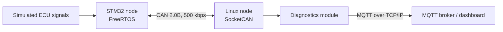

# System Architecture

## Block diagram

## FreeRTOS tasks (planned)

| Task | Priority | Role |
|---|---|---|
| CAN RX | High | Receive frames and push them to a queue |
| CAN TX | Medium | Send periodic signal frames |
| Signal task | Medium | Read or simulate signal values |
| Health monitor | Low | Watch error counters and bus-off state |

## Design decisions

- **Queues between tasks:** the receive handler only stores frames, so the heavy processing happens outside it and no frames are lost.
- **Two nodes:** the STM32 handles real-time CAN work, while Linux handles analysis and networking, as in a real vehicle gateway.
- **Status:** design stage. This page will be updated as each part is built and tested.
